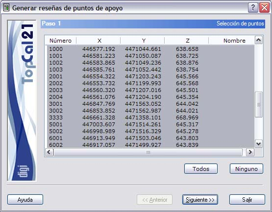

# Step 1: Point selection
<!-- id: topcal21-generar-resenas-de-puntos-de-apoyo-paso-1-seleccion-de-puntos -->
<!-- origen: 19d975039df116dd71e9cab4b8c7a361c8c4f6ab -->

This is the first step to generate control point data sheets.

A screen is shown with the points with coordinates stored in the current file. Select the points for which you want to generate the data sheets.

The list shown contains the following fields:

* **Point number**
* **Point coordinates**
* **Point name**

You can select multiple points by holding down the *\[CTRL\]* key and clicking the desired points with the left mouse button. If you click a point that is already selected, it is deselected.

You can also select points arranged in ranges, by holding down the *\[SHIFT\]* key and clicking with the left mouse button the limit points that define the range.

Likewise, you can use the **All** or **None** buttons to select or deselect all the points.

Once you have selected the desired points, you can click the **Next** button to go to [Step 2: Enter the data sheets](paso-2-introduccion-de-resenas.md).
