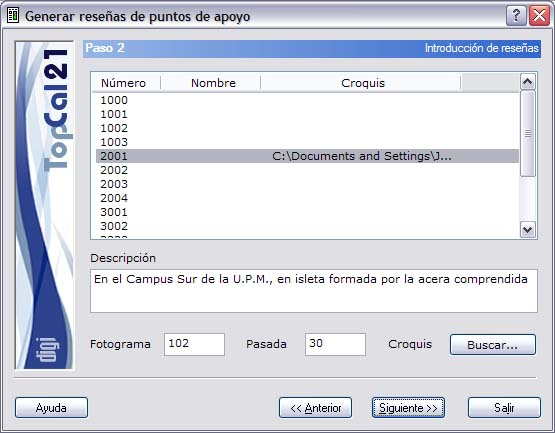

# Step 2: Enter the data sheets
<!-- id: topcal21-generar-resenas-de-puntos-de-apoyo-paso-2-introduccion-de-resenas -->
<!-- origen: f3877a5f59e65725f81fbb1696645c156ee487f5 -->

This is the second step to generate control point data sheets.

The program shows a list with the points selected in the previous step, where you must enter the additional data, if they were not entered on another occasion, to fill in the control point sheet. You must also choose the file that contains the sketch of the point.

These fields include the following:

* **Description**: Information about the characteristics of the control point.
* **Photogram**: Photogram whose central area contains the control point.
* **Strip**: Strip in which the point lies.

When you have filled in all the information for the points, you can click the **Next** button to go to [Step 3: Enter output files](paso-3-introducir-ficheros-de-salida.md) or return to [Step 1: Point selection](paso-1-seleccion-de-puntos.md) by clicking the **Back** button.
