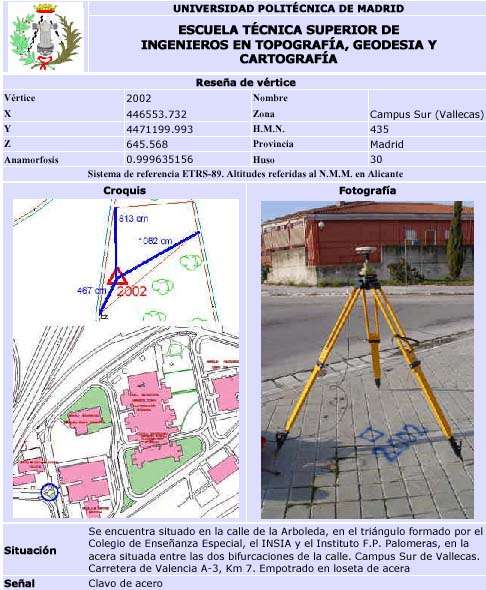

# Generate vertex data sheets
<!-- id: generar-resenas-de-vertices -->
<!-- origen: 46c939a5fc42f83798d5fd0acb9ebcc0e32f2f1d -->

This tool generates data sheets of vertices from a set of points stored in a TopCal file. The program generates a file in html format from a template predesigned by the user. There is, however, a default template included with the program.

The data of the vertex data sheets that the user enters are stored in the point file, so that they can be used on later occasions.

The computation is made up of three steps, as follows:

* [Step 1: Point selection](paso-1-seleccion-de-puntos.md)
* [Step 2: Enter the data sheets](paso-2-introduccion-de-resenas.md)
* [Step 3: Enter output files](paso-3-introducir-ficheros-de-salida.md)

Use the **Next** and **Back** buttons to move between steps and modify the data or the selections.
