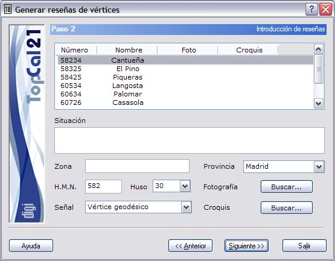

# Step 2: Enter the data sheets
<!-- id: topcal21-generar-resenas-de-vertices-paso-2-introduccion-de-resenas -->
<!-- origen: a1b9c19e7f1b33f850c8705319e4e70b257420a1 -->

This is the second step to generate vertex data sheets.

The program shows a list with the points selected in the previous step, where you must enter the additional data, if they were not entered on another occasion, to fill in the vertex sheet. You must also choose the files that contain the photograph and the sketch of the point.

These fields include the following:

* **Situation**: Literal description of the location of the point.
* **Zone**: Place within the province where the point lies.
* **Province**: Select a province.
* **Sheet**: National Map Sheet (H.M.N.) where the point lies.
* **UTM Zone**.
* **Marker**: Type of sign used to mark the point.

When you have filled in all the information for the points, you can click the **Next** button to go to [Step 3: Enter output files](paso-3-introducir-ficheros-de-salida.md) or return to [Step 1: Point selection](paso-1-seleccion-de-puntos.md) by clicking the **Back** button.
