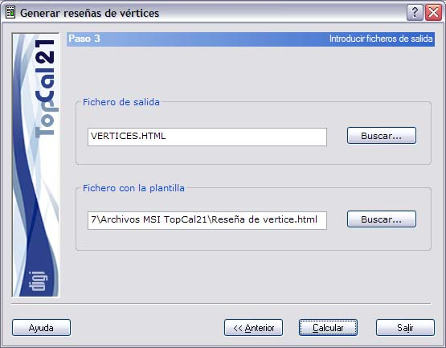

# Step 3: Enter output files
<!-- id: topcal21-generar-resenas-de-vertices-paso-3-introducir-ficheros-de-salida -->
<!-- origen: a8d25accab7215cd620e1e68ba46c4b20436a91a -->

This is the third and last step to generate vertex data sheets.

The following fields are shown:

* **Output file**: Enter a name for the output html file or locate it using the Windows explorer that appears when you click the **Search** button. This file can be viewed (with the viewer specified in the [Preferences](../../opciones-de-visualizacion/preferencias.md) dialog box of the [Edit](../../menus-de-la-aplicacion/menu-editar.md) menu) if you activate the checkbox at the bottom named **Show after computation**.
* **Template file**: Enter the name of the html template used to generate the data sheets. This template can have been created by the user, or you can use the template included with the program.

Once the output data are set up, you can finish the process by clicking the **Compute** button or return to the previous step, [Step 2: Enter the data sheets](paso-2-introduccion-de-resenas.md), by clicking the **Back** button.

When the generation of the data sheets finishes, the program saves in the point file the data entered for each vertex, so that the user can generate the data sheets again without entering the data again.
