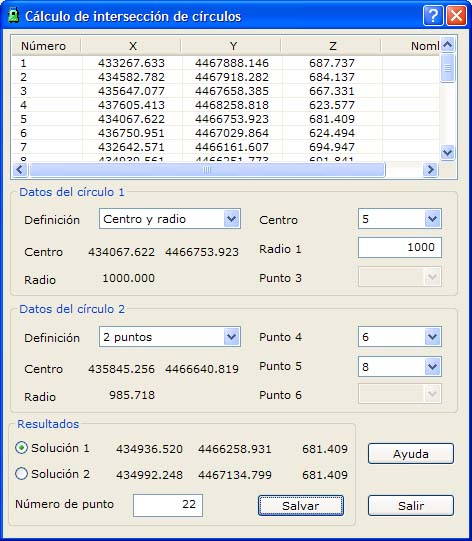

# Circle intersection
<!-- id: interseccion-de-circulos -->
<!-- origen: ab6c357d4cb03b2cc59fbf0ae22ab751a1dcde78 -->

This tool is used to compute the intersection between two circles. These circles can be defined in any of the following ways:

* **Three points**: Circle that passes through three points
* **Two points**: Circle whose diameter is defined by two points
* **Centre and radius**
* **Centre and one point of the circle**: Circle with its center at one point that passes through another point

Depending on which type of definition is selected, the fields corresponding to those definitions are enabled or disabled. The fields shown are the following:

* **Point list**: List of points of the current file
* **Data of circle 1**
  * *Definition*: Type of definition. The possibilities and fields to fill in are the following:
    * *3 points*: Point 1, Point 2, Point 3
    * *2 points*: Point 1, Point 2
    * *Centre and Radius*: Centre, Radius in meters
    * *Centre and Point*: Centre, Point of Circle
  * *Centre*: Computed center
  * *Radius*: Computed radius in meters
* **Data of circle 2**
  * *Definition*: Type of definition. The possibilities and fields to fill in are the following:
    * *3 points*: Point 4, Point 5, Point 3
    * *2 points*: Point 4, Point 5
    * *Centre and Radius*: Centre, Radius
    * *Centre and Point*: Centre, Point of Circle
  * *Centre*: Computed center
  * *Radius*: Computed radius in meters
* **Results**
  * *Solution 1*
  * *Solution 2*
  * *Point number*

Once the intersection has been computed, you can click the **Save** button to save the selected solution in the point file, with the point number indicated in the **Point number** field.

