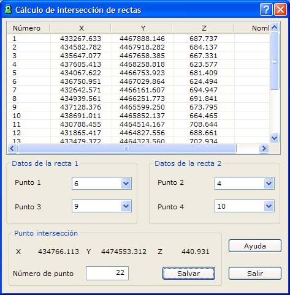

# Straight line intersection
<!-- id: interseccion-de-rectas -->
<!-- origen: 53012d1ce9e6fc67747631ccd181ea7280f12ef1 -->

This tool is used to compute the intersection between straight lines. The straight lines can be defined by two points or by a point and an azimuth.

Depending on which type of definition of the straight line is selected, the fields corresponding to those definitions are enabled or disabled. The fields shown are the following:

* **Point list**: List of points of the current file
* **Data of straight line 1**. Depending on the selected option, it can show
  * *Point 1, Point 3*
  * *Point 1, Azimuth 1*
* **Data of straight line 2**. Depending on the selected option, it can show
  * *Point 2, Point 4*
  * *Point 2, Azimuth 2*
* **Intersection point**
  * *X, Y, Z coordinates*
  * *Point number*

Once the intersection has been computed, click the **Save** button to save the intersection point in the point file with the number indicated in the **Point number** field.

