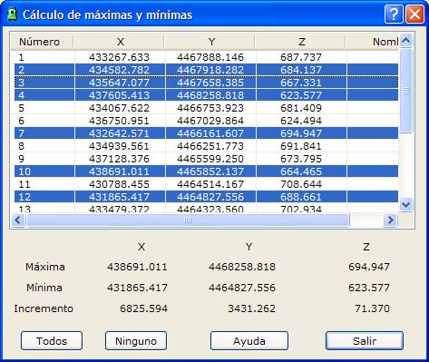

# Maxima and minima
<!-- id: maximas-y-minimas -->
<!-- origen: cdfb4276045c3d9cad299ce6dbc50cc902ef689c -->

This tool is used to compute the maximum and minimum coordinates of a given set of points. The fields shown are the following:

* **Point list**: List of points of the current file
* **Maximal X, Y, Z**: Maximum coordinates of the selected points
* **Minimal X, Y, Z**: Minimum coordinates of the selected points
* **Increments X, Y, Z**: Differences between the maxima and minima of the selected points

You can select multiple points by holding down the *\[CTRL\]* key and clicking the desired points with the left mouse button. If you click a point that is already selected, the program deselects that point.

You can also select ranges of points by holding down the *\[SHIFT\]* key and clicking with the left mouse button the limit points that define the range.

In the same way, you can use the **All** or **None** buttons to select all points or deselect all points, respectively.

