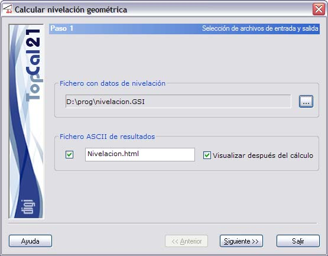

# Step 1: Input and output file selection
<!-- id: topcal21-nivelacion-geometrica-paso-1-seleccion-de-archivos-de-entrada-y-salida -->
<!-- origen: dc1dcf9a576fc593d4ddbf20d5065515bbc00557 -->

This is the first step in the levelling computation.

A screen is displayed where you must enter the input file with the data and the output file with the levelling computation:

* **Levelling data file**: You can select the input file by clicking the button to the right of the file name. This file must be in the GSI format generated by Leica levels.
* **ASCII output file**: This file can be in HTML or ASCII format. If the extension of this file is HTM or html, it is treated as HTML format; otherwise, it is treated as ASCII format. You can view this file (with the viewer specified in the [Preferences](../../opciones-de-visualizacion/preferencias.md) dialog box of the [Edit menu](../../menus-de-la-aplicacion/menu-editar.md)) by selecting the check box to the right, named **Show after computation**. The results file is created in the directory of the levelling data file.

Once these data are entered, click the **Next** button to go to Step 2: Computed height differences.
