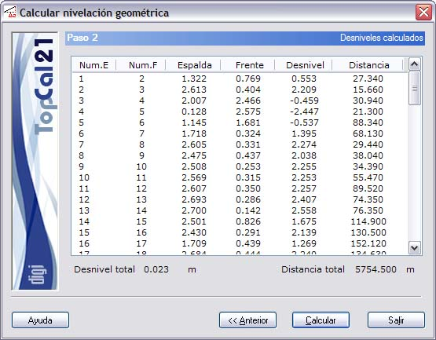

# Step 2: Computed height differences
<!-- id: topcal21-nivelacion-geometrica-paso-2-desniveles-calculados -->
<!-- origen: 729272100a5929fa79028a7e5c2f26d7f063c092 -->

This is the second and last step in the levelling computation.

A list is displayed with the computations distributed in the following columns:

* **Num.B**: Number of the point targeted with the backsight observation.
* **Num.F**: Number of the point targeted with the foresight observation.
* **Backsight**: Backsight reading, in meters.
* **Foresight**: Foresight reading, in meters.
* **Height difference**: Height difference, in meters, computed from the observations.
* **Distance**: Distance, in meters, between the rods.

At the bottom, the total computed height difference is displayed, as well as the distance between the initial and final points.

Once you have reviewed the computed data, you can finish the process by clicking the **Compute** button, or return to the previous step, [Step 1: Input and output file selection](paso-1-seleccion-de-archivos-de-entrada-y-salida.md), by clicking the **Back** button.
