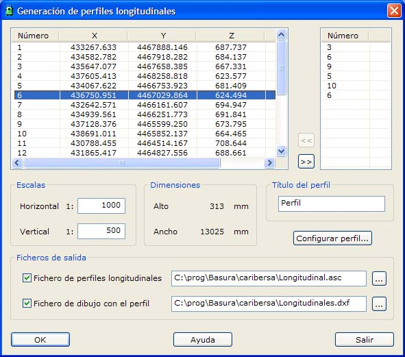

# Longitudinal profiles
<!-- id: perfiles-longitudinales -->
<!-- origen: 5cae1ca7225ab6bd22079cdf1df6370fd472fbe7 -->

This tool computes longitudinal profiles made up of a set of points stored in a TopCal point file.

The program displays a dialog box with the available points, showing their coordinates and their point number. To the right of this list, the points that will be part of the profile are displayed. You can add them by double-clicking the point in question or by clicking the **>>** button. You can also remove them from the profile with the **&lt;&lt;** button.

You can specify the horizontal and vertical scales for generating the corresponding drawing file. The dialog box then shows the plotting size, in millimeters, that the profile will have, depending on its length, the scales and the options of the profile table (the lower part of the profile frame, which shows elevations, distances and point numbers).

The program can also generate two types of output files:

* A text file with the list of the points that make up the profile.
* A drawing file with the longitudinal profile and a profile table with the information relating to it. You can customize this profile table through its own [dialog box](configuracion-de-la-guitarra.md). The file format depends on its extension:
  * BIN extension for DIGI files.
  * DXF extension for AutoCAD files.
  * DGN extension for MicroStation files: In this case, when you click the **OK** button, the program displays a [dialog box](../../otros-comandos/parametros-para-exportar-a-dgn.md) where it asks you for the name of the file that will act as the seed file and, if you have one, a translation table from TopCal codes to the MicroStation coding system (level, style, color, weight and graphic group).
