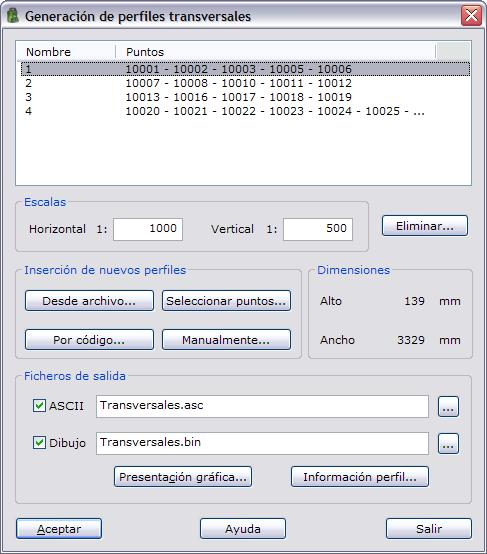

# Cross sections
<!-- id: topcal21-perfiles-transversales -->
<!-- origen: e26d2d1fdde85f9709f2f8e17a07c7c573c07141 -->

TopCal 21 lets you build cross sections with this tool, offering several ways to enter the data:

* [From an ASCII file](insercion-de-nuevos-perfiles-desde-archivo.md): From an ASCII file of points that gives the elevation and the distance from the axis.
* [Selecting points from the current file](insercion-de-nuevos-perfiles-seleccionando-puntos.md): You interactively choose the points that make up the profile.
* [Selecting points from the current file according to their code](insercion-de-nuevos-perfiles-por-codigo.md): The program selects the profiles made up of points whose code matches.
* [Manually](insercion-de-nuevos-perfiles-manualmente.md): By entering the value of the distance from the axis and the elevation for each point that makes up the profile.

In this way, you can add all the profiles you want by any of these methods; they are shown in the list at the top of the dialog box. You can also delete a profile from this list by clicking the **Delete** button.

In addition, you can specify the **horizontal** and **vertical** scales for generating the corresponding drawing file. The program automatically computes the dimensions that the drawing file would have in plotting coordinates, to determine whether the selected profiles fit on the plot sheet. The scale values and the plotting dimensions are only useful if you want to obtain a drawing file.

The program can generate two different types of output files:

* A **text file** with the list of the points that make up the profile. This file contains a list with the name of each profile followed by the points that make up the profile, showing in columns their number, distance from the axis, elevation and accumulated distance of the profile.
* A **drawing file** with all the cross sections. If you select this type of file, the buttons to configure its output are enabled:
  * [Graphic presentation](presentacion-grafica-de-los-perfiles-transversales.md): To configure how the profiles are organized within the drawing file.
  * [Profile information](configuracion-de-la-guitarra.md): To select the fields that appear in the profile table (the lower part of the profile frame, which shows elevations, distances and point numbers) and to configure the texts: their position, their drawing code and their height.

  The file format depends on its extension:
  * BIN extension for DIGI files.
  * DXF extension for AutoCAD files.
  * DGN extension for MicroStation files: In this case, when you click the **OK** button, the program displays a [dialog box](../../otros-comandos/parametros-para-exportar-a-dgn.md) where it asks you for the name of the file that will act as the seed file and, if you have one, a translation table from TopCal codes to the MicroStation coding system (level, style, color, weight and graphic group).

You can select the location of both files by clicking the corresponding button to the right of the file name. If you do not specify a folder, the output files are generated in the project folder if the point file belongs to a project, or otherwise in the folder of the point file.
