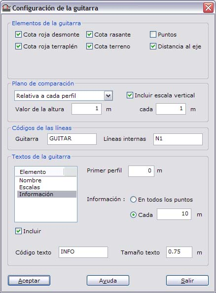

# Cross section profile table setup
<!-- id: configuracion-de-la-guitarra-de-perfiles-transversales -->
<!-- origen: 73225f27c139623f2edd825fb0b3c55c2b69f507 -->

From this dialog box you can configure the appearance of the frame that contains each cross section, as well as the additional information that appears in it.

At the top of the dialog box, select the **elements** that the lower part of the frame, or profile table (the part that shows elevations, distances and point numbers), will include. The program fills in these fields automatically from the computed profiles. These fields are:

* **Red elevation cut/fill**: Difference between the design elevation and the terrain elevation. If the *design elevation* is lower than the *terrain elevation*, the difference represents cut depth; otherwise, it represents fill height.
* **Design/terrain elevation**: Elevation value on the design profile or on the digital model, that is, the terrain.
* **Distance to axis**: Distance, in meters, to the axis of the cross section.
* **Points**: Number of the profile point.

Next, configure the position of the comparison plane of the frame and whether you want a vertical scale, using the following fields:

* **Comparison plane**: In this field you choose how the program computes the altitude of the comparison plane of the profiles. If you choose the *Absolute* option, the program places the plane at the elevation given in the *Height value* field. If you choose the *Relative to each profile* option, the program computes the altitude of the plane by subtracting the amount given in the *Height value* field from the lowest elevation of each profile. If you choose the *Relative to all profiles* option, the program computes the altitude of the plane by subtracting the amount given in the *Height value* field from the lowest elevation of all the profiles.
* **Height value**: Indicates the value, in meters, of the absolute or relative altitude of the comparison plane.
* **Include vertical scale**: Select this check box if you want to draw horizontal lines parallel to the comparison plane that help to read the profile, since they indicate different altitude values. The distance between these lines is given in the field below this check box.

Then, specify the code in which the entities that make up the box of the profile table itself are recorded, using the **Profile table code** and **Internal lines code** fields.

Finally, select from the list which texts will appear in the frame and around it. If you want a given text to appear, select the **Include** check box below that list. When you select it, the parameters for the text are displayed; except for the Information texts, they are common to all of them. The parameters are:

* **Position**: Indicates the position of the text relative to the profile frame; it can be placed around it.
* **Text code**: Indicates the drawing code with which the text is recorded.
* **Text height**: Indicates the height of the text, in meters.

The texts that you can include are the following:

* **Name**: Indicates the name of the profile.
* **Scales**: Indicates the value of the horizontal and vertical scale of the profile, as specified in the [Cross Sections](README.md) [dialog box](README.md).
* **Information**: These texts are generated for the fields selected at the top of the dialog box and are displayed as a profile table in the lower part of the frame. The setup of these texts differs from the rest and contains the following fields:
  * *First profile*: Indicates the number from which the program numbers the rest of the profiles consecutively.
  * *Information*: Indicates whether you want information at every profile inflection point where the information labels do not overlap or at a given distance interval.

