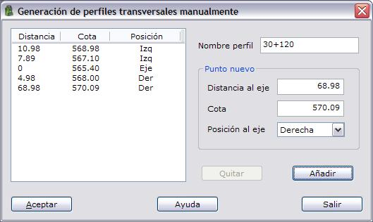

# Inserting new profiles manually
<!-- id: insercion-de-nuevos-perfiles-manualmente -->
<!-- origen: ad1fa452a4cc158e8fc18b6b321b631ac53effb5 -->

You can insert profiles by manually entering the characteristics of the points that make up each profile.

The program displays a dialog box where you can add the points by filling in the following fields:

* **Distance from the axis**: Enter the value of the distance from the axis. You do not need to enter a sign in this field; it is assigned automatically according to the position of the point. If the value is zero, the point is interpreted as a point on the axis. You cannot add two points with a distance equal to zero.
* **Height**
* **Position axis**: Indicate the position of the point relative to the axis, left or right. Points located on the left are assigned a negative distance from the axis.

You can enter the points without sorting them by distance from the axis, since the program sorts them according to their distance from the axis.

To add a point, click the **Add** button. To delete a point, select it from the list and then click the **Delete** button.

Before accepting the data, assign a name to the profile in the **Profile name** field.
