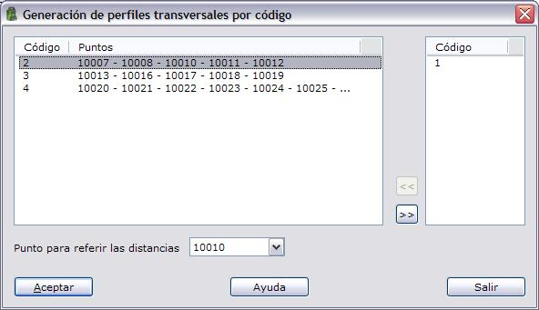

# Inserting new profiles by code
<!-- id: insercion-de-nuevos-perfiles-por-codigo -->
<!-- origen: 233e609ed07db5179b3d5d3747f86b8dbdd3ad18 -->

You can insert profiles from the points stored in the current point file, using the code to relate them automatically.

The program displays a list with the profiles formed by grouping the points of the current file: the points that make up a profile must be consecutive in the file and have the same code.

You can select the profiles you want and designate which of the points that make up the profile acts as the origin for measuring distances. You can enter this information in the field located below the list of profiles.

To include a profile, select it from the list and click the **>>** button, or double-click it with the left mouse button. You can also remove a profile from the list of selected profiles by clicking the **&lt;&lt;** button, or by double-clicking it with the left mouse button in this list.

The value of the code field is used as the name of the profile.
