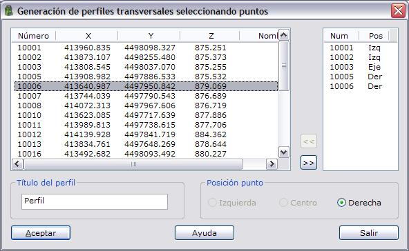

# Inserting new profiles by selecting points
<!-- id: insercion-de-nuevos-perfiles-seleccionando-puntos -->
<!-- origen: 4653fe8fe084c251734e089ed85b39e80f7ce034 -->

You can insert new cross sections by selecting the points that make up the profile from the current point file.

The program displays a dialog box with the list of all the points that can be included in the profile.

To include a new point in the profile, select it from the list and click the **>>** button, or double-click it with the left mouse button. Before including it, indicate whether the point lies to the left of the cross-section axis, to its right, or on the axis. To do so, choose the option in the **Point position** field.

The program lets you keep entering points to the left of the axis until you designate a point that acts as the axis. From then on, points can only be included to the right of the axis.

You can also remove a point from the list of selected points by clicking the **&lt;&lt;** button, or by double-clicking it with the left mouse button in this list.

The program allows points to be repeated in the profile setup.

Before accepting the data, assign a name to the profile in the **Profile title** field.
