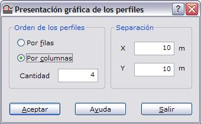

# Graphic presentation of cross sections
<!-- id: presentacion-grafica-de-los-perfiles-transversales -->
<!-- origen: bca7b5cd1a8439f12aa7aaa6808dca177e427a8a -->

With this tool you can configure how the profiles are presented within the drawing file; they can be arranged in rows or columns, and you can specify the maximum number of profiles in each series. The dialog box that is displayed contains the following fields to fill in:

* **Profile order**: Whether the profiles are aligned by columns or by rows.
* **Number per row or column**: Number of profiles in each row or column.
* **X / Y separation**: Separation, in meters, between profiles on each axis.
