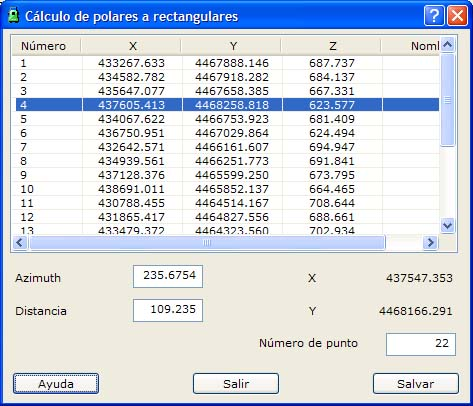

# Polar to rectangular coordinates
<!-- id: polares-a-rectangulares -->
<!-- origen: 9a5eb45eed01fd2c0c8fb08af1ffe84177720510 -->

This tool is used to compute the coordinates of a point from the azimuth and the distance measured from another point of known coordinates. The dialog box shows the following fields:

* **Point list**: List of points of the current file. Select a point from which the coordinates of the new point are computed
* **Azimuth**: In grads.
* **Distance**: In meters.
* **X, Y coordinates of the computed point**
* **Point number**

Once the point has been computed, click the **Save** button to save the computed point in the point file with the number indicated in the **Point number** field.

