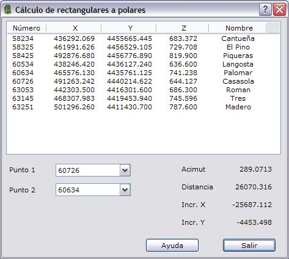

# Rectangular to polar coordinates
<!-- id: rectangulares-a-polares -->
<!-- origen: a45ac4510e65831e043ecf7cf8d9a9e1099e15d7 -->

This tool is used to compute the azimuth and the distance between two points. The dialog box shows the following fields:

* **Point list**: List of points of the current file. Select in **Point 1** and **Point 2** the two points between which you want to compute the azimuth and the distance.
* **Point 1:** First point to compute the azimuth and the distance
* **Point 2**: Second point to compute the azimuth and the distance
* **Azimuth**: In grads.
* **Distance**: In meters.
* **Increment X**: In meters.
* **Increment Y**: In meters.

This tool does not save any result in the file; it only shows computed data.

