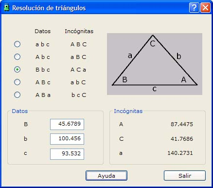

# Triangle solving
<!-- id: resolucion-de-triangulos -->
<!-- origen: e583f91f8ef9b41f29f1e1d1f82fd4ac8c3b6bd0 -->

This tool is used to compute the elements of a triangle when certain data of that triangle are known. The data corresponding to the sides are shown in lowercase letters and the data corresponding to the angles are shown in uppercase letters, as the figure shows. The dialog box shows the following fields:

* **Selection of the data and unknowns**. The options are the following:
  * If the three sides are known (a, b, c)
  * If an angle and its sides are known (A, b, c)
  * If angle B, its opposite side b and the adjacent side c are known (B, b, c)
  * If two angles and their common side are known (A, B, c)
  * If two angles and a non-common side are known (A, B, a)
* **Value of the data**: If they are angles, the values are given in grads. If they are sides, they are given in meters.
* **Value of the unknowns**: If they are angles, the values are given in grads. If they are sides, they are given in meters.

This tool does not save any result in the file; it only shows computed data.

