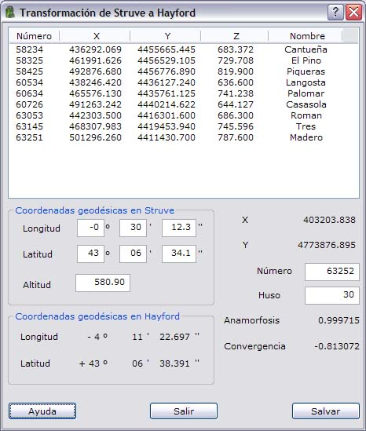

# Transformation of coordinates from the Struve ellipsoid to Hayford
<!-- id: transformacion-de-coordenadas-del-elipsoide-de-struve-al-de-hayford -->
<!-- origen: 1680737f40fd85d1ec19c3fada3acfef27174226 -->

The application has a tool that lets the user transform the coordinates of the old Spanish geodetic network, whose ellipsoid was the Struve ellipsoid and whose datum was in Madrid.

To do this, the program shows a dialog box where you can add new points to the file by entering only the geodetic coordinates (**longitude** and **latitude**) in that system and the UTM zone in which the point is located, in order to transform these coordinates into coordinates in the ED-50 system (datum in Potsdam) and in UTM projection.

Once the point has been computed, click the **Save** button to save the computed point in the point file with the number indicated in the **Point number** field and the height indicated in the **Height** field.

