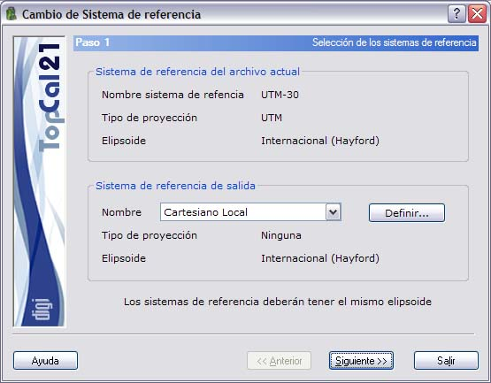

# Step 1: Reference system selection
<!-- id: topcal21-transformacion-de-coordenadas-entre-diferentes-sistemas-de-referencia-paso-1-seleccion-de-los-sistemas-de-referencia -->
<!-- origen: ac3dd12a11b15048adab7cf2fea123174e46293e -->

In the first step of the reference system change, the input and output systems are displayed. The input reference system is the one defined for the current file that is going to be transformed.

You can choose the output reference system from the list available for this purpose. For a correct transformation, it is recommended that the chosen output reference system has the same ellipsoid as the input system.

If the reference system you want is not available in the list, you can click the **Define** button to create a new one. The program then displays the [Reference systems](../../otros-comandos/sistemas-de-referencia/listado-de-sistemas-de-referencia.md) dialog box.

Once these data are entered, click the **Next** button to go to [Step 2: Point selection](paso-2-seleccion-de-puntos.md).
