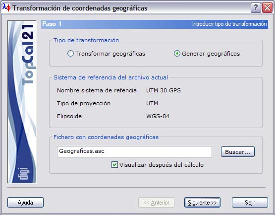

# Step 1: Enter the transformation type
<!-- id: topcal21-transformacion-de-coordenadas-geograficas-paso-1-introducir-tipo-de-transformacion -->
<!-- origen: 7815ecb9b0897e41d9fe3a18e4b2dca79882c610 -->

This is the first step in computing the transformation of geographic coordinates, in which you specify the type of transformation to perform. The characteristics of the reference system of the current file, used for the transformation of the geographic coordinates, are also displayed. The required data are as follows:

* **Type of transformation**:
  * *Transform geographics*: Select this option if you want to transform a file of geographic coordinates into the current point file. The ASCII file with the geographic coordinates must have the data arranged in columns, separated by spaces, commas or tabs, with the following fields: *Point number*, *Longitude* in sexagesimal degrees in pseudo-decimal format, *Latitude* in sexagesimal degrees in pseudo-decimal format, *Height* in meters and the point *Name* if it has one.

To enter angles in pseudo-decimal format, enter the degrees, a decimal point, two digits for the minutes, two digits for the seconds and the decimals of the seconds. For example, the angle 90 degrees 38 minutes 45.67 seconds is entered as 90.384567.

* *Generate geographics*: Select this option if you want to transform the current point file into a file with geographic coordinates. This file can be in HTML or ASCII format. If the extension of this file is HTM or html, it is treated as HTML format; otherwise, it is treated as ASCII format. You can view this file (with the viewer specified in the [Preferences](../../opciones-de-visualizacion/preferencias.md) dialog box of the [Edit menu](../../menus-de-la-aplicacion/menu-editar.md)) by selecting the check box below, named **Show after computation**. The generated file has the following fields: *Point number*, *Longitude* in sexagesimal degrees in pseudo-decimal format, *Latitude* in sexagesimal degrees in pseudo-decimal format, *Height* in meters, the *linear anamorphosis coefficient* of the UTM projection and the *Meridian convergence* in sexagesimal degrees in pseudo-decimal format.
* **Geographic coordinates file**: Enter the name of the ASCII file with the geographic coordinates. This file must exist if you chose *Transform geographics* as the transformation type, or it is created as a new file if you chose the *Generate geographics* option. By default, the location of this file is the same as that of the current point file. To change the location, you can use the **Browse** button.

Once these data are entered, click the **Next** button to go to [Step 2: Selection of the points to transform](paso-2-seleccion-de-los-puntos-a-transformar.md).
