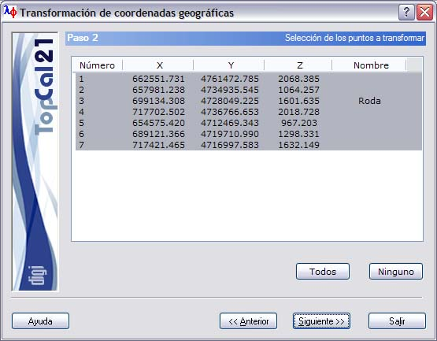
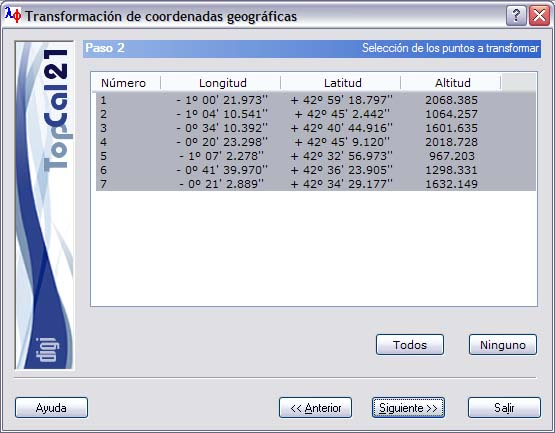

# Step 2: Selection of points to transform
<!-- id: topcal21-transformacion-de-coordenadas-geograficas-paso-2-seleccion-de-puntos-a-transformar -->
<!-- origen: 1a0b7a7cc3a10888a53a4437e54304f877918903 -->

This is the second step in computing the transformation of geographic coordinates.

If the transformation selected in the previous step was *Transform geographics*, a screen is displayed with the geographic coordinates of the points read from the specified file. This list contains the following fields:

* **Point number**
* **Longitude**, in sexagesimal degrees
* **Latitude**, in sexagesimal degrees
* **Height**

If the transformation selected in the previous step was *Generate geographics*, a screen is displayed with the coordinates of the points of the current file. This list contains the following fields:

* **Point number**
* **Point coordinates**
* **Point name**

In this step, select the points you want to transform.

You can select multiple points by holding down the *\[CTRL\]* key and clicking the desired points with the left mouse button. If you click a point that is already selected, it is deselected.

You can also select points arranged in ranges by holding down the *\[SHIFT\]* key and clicking with the left mouse button the limit points that define the range.

Likewise, you can use the **All** or **None** buttons to select or deselect all the points.

When you have selected the desired points, you can click the **Next** button to go to [Step 3: Transformed coordinates of the points](paso-3-coordenadas-transformadas-de-los-puntos.md), or return to [Step 1: Enter the transformation type](paso-1-introducir-tipo-de-transformacion.md) by clicking the **Back** button.
