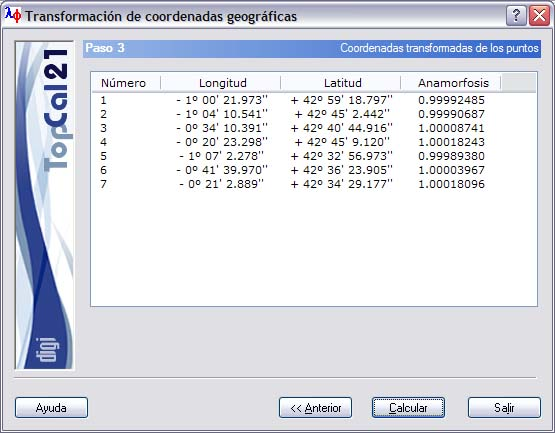
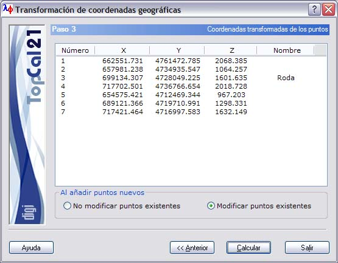

# Step 3: Transformed coordinates of the points
<!-- id: topcal21-transformacion-de-coordenadas-geograficas-paso-3-coordenadas-transformadas-de-los-puntos -->
<!-- origen: 4024b86441fad556b63e7ff999cf712a3cc7ece1 -->

This is the third and last step in computing the transformation.

If the transformation selected in [step 1](paso-1-introducir-tipo-de-transformacion.md) was *Transform geographics*, a screen is displayed with the coordinates of the points selected in the previous step, referred to the reference system of the current point file. This list contains the following fields:

* **Point number**
* **Point coordinates**
* **Point name**

When adding the transformed points to the current point file, you can select *Not modify existing points* or *Modify existing points* that have the same number.

If the transformation selected in [step 1](paso-1-introducir-tipo-de-transformacion.md) was *Generate geographics*, a screen is displayed with the geographic coordinates of the points selected in the previous step. This list contains the following fields:

* **Point number**
* **Longitude**, in sexagesimal degrees
* **Latitude**, in sexagesimal degrees
* If the projection of the current file is UTM, the **Linear anamorphosis** of the projection at this point is displayed. Otherwise, the **Height** of the point is displayed.

Once the output data have been configured, you can finish the process by clicking the **Compute** button, or return to the previous step, [Step 2: Selection of points to transform](paso-2-seleccion-de-los-puntos-a-transformar.md), by clicking the **Back** button.
