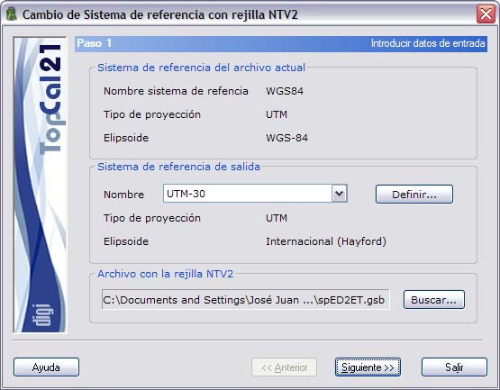

# Step 1: Enter input data
<!-- id: topcal21-transformacion-de-coordenadas-utilizando-rejilla-ntv2-paso-1-introducir-datos-de-entrada -->
<!-- origen: 5070ae697b4c3d8dc8d0c57c14336e61af22c37b -->

In the first step of the reference system change using an NTV2 grid, the input and output systems and the file that contains the grid are displayed.

The input reference system is the one defined for the current file that is going to be transformed.

You can choose the output reference system from the list available for this purpose.

Select input and output reference systems that match those defined in the header of the NTV2 grid. To find out which systems are defined in that header, go on to Step 2.

If the reference system you want is not available in the list, you can click the **Define** button to create a new one. The program then displays the [Reference systems](../../otros-comandos/sistemas-de-referencia/listado-de-sistemas-de-referencia.md) dialog box.

Finally, specify the file that contains the NTV2 grid. The TopCal 21 installation provides a grid for transformations between the ED-50 and ETRS-89 systems that is valid for Spain. This file is installed in the same folder in which the program has been installed and is named "spED2ET.gsb".

Once these data are entered, click the **Next** button to go to [Step 2: Calculation mode setup](paso-2-configurar-modo-de-calculo.md).
