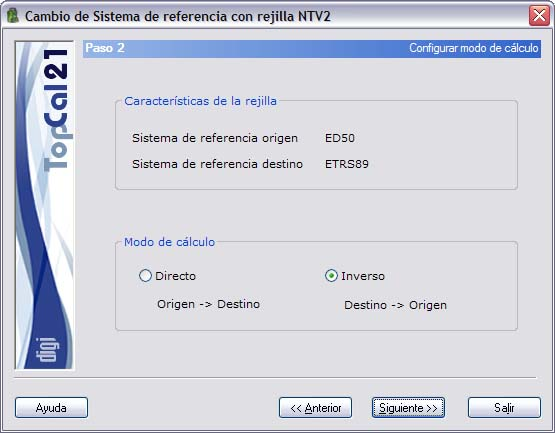

# Step 2: Calculation mode setup
<!-- id: topcal21-transformacion-de-coordenadas-utilizando-rejilla-ntv2-paso-2-configurar-modo-de-calculo -->
<!-- origen: b48a7cbf464462bc9144a0e1749a5e9138b3f9c6 -->

This is the second step in the reference system change using an NTV2 grid, in which the reference systems between which coordinates can be transformed using the file defined in the previous step are displayed.

As indicated in Step 1, these reference systems should match those defined in the TopCal files that are being transformed. Otherwise, the computation will not be correct.

In addition, in this step you must choose the direction of the coordinate transformation:

* **Direct**: You start from coordinates defined as Origin and want to obtain the coordinates defined as Target.
* **Indirect**: You start from coordinates defined as Target and want to obtain the coordinates defined as Origin.

Once the calculation mode has been configured, you can click the **Next** button to go to [Step 3: Point selection](paso-3-seleccion-de-puntos.md), or return to [Step 1: Enter input data](paso-1-introducir-datos-de-entrada.md) by clicking the **Back** button.
