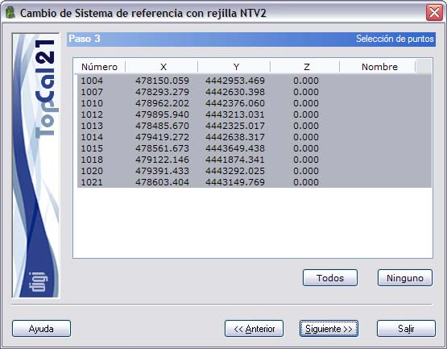

# Step 3: Point selection
<!-- id: topcal21-transformacion-de-coordenadas-utilizando-rejilla-ntv2-paso-3-seleccion-de-puntos -->
<!-- origen: a4c406e1e6c76e82a148eca3ca4ea8313316ea11 -->

This is the third step in the reference system change using an NTV2 grid, in which a screen is displayed with the points with coordinates stored in the current file. Select the points you want to transform.

The list that is displayed contains the following fields:

* **Point number**
* **Point coordinates**
* **Point name**

You can select multiple points by holding down the *\[CTRL\]* key and clicking the desired points with the left mouse button. If you click a point that is already selected, it is deselected.

You can also select points arranged in ranges by holding down the *\[SHIFT\]* key and clicking with the left mouse button the limit points that define the range.

Likewise, you can use the **All** or **None** buttons to select or deselect all the points.

When you have selected the desired points, you can click the **Next** button to go to [Step 4: Output data setup](paso-4-configurar-salida-de-datos.md), or return to [Step 2: Calculation mode setup](paso-2-configurar-modo-de-calculo.md) by clicking the **Back** button.
