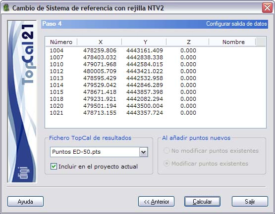

# Step 4: Output data setup
<!-- id: topcal21-transformacion-de-coordenadas-utilizando-rejilla-ntv2-paso-4-configurar-salida-de-datos -->
<!-- origen: 81d911024f76b80949085a088174bc4de7372814 -->

This is the fourth and last step in the reference system change using an NTV2 grid where, in addition to a list with the coordinates of the transformed points, the following fields are displayed:

* **TopCal output file**: You can select the name of the TopCal file where the points will be stored. You can choose one of the existing files or generate a new file. If you want to generate a new file, you can choose whether or not to add the file to the current project.
* **Adding new points**: If the point file already exists, you can choose **Modify existing points** or **Not modify existing points** for the points of the output file whose number matches that of the computed points.

Once the output data have been configured, you can finish the process by clicking the **Compute** button, or return to the previous step, [Step 3: Point selection](paso-3-seleccion-de-puntos.md), by clicking the **Back** button.
