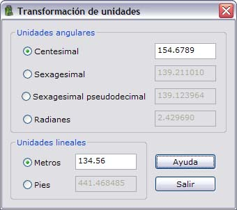

# Transformation of units
<!-- id: transformacion-de-unidades -->
<!-- origen: b3ecd42fba68c24931e5f543bcd6f0e629670d19 -->

This tool is used to transform values expressed in one angular or linear unit into another. In this way, you only need to specify the unit in which you will enter the input value, and the program computes the transformed value in the rest of the units of the same type of unit.

If you transform angular units, you can choose between:

* *Grads*: Angles whose full circle has 400 grads (centesimal).
* *Degrees*: Angles whose full circle has 360 degrees (sexagesimal).
* *Pseudodecimal degrees*: Angles whose full circle has 360 degrees, but in which the first two digits after the decimal separator represent the minutes, the next two represent the seconds, and the remaining ones represent the decimals of the seconds (sexagesimal).
* *Radians*: Angles whose full circle is equivalent to 2π radians.

If you transform linear units, you can choose between:

* *Metres*
* *Feet*

To use this tool, you do not need to have any type of document open or active.

