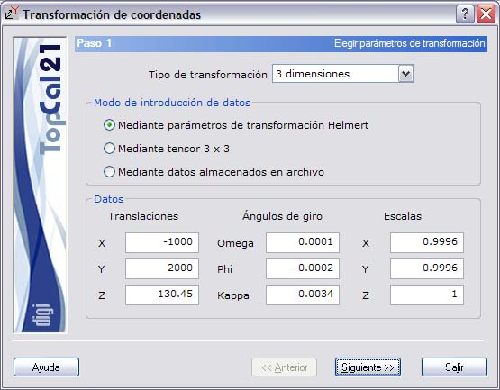

# Step 1: Choose transformation parameters
<!-- id: topcal21-transformacion-helmert-de-coordenadas-paso-1-elegir-parametros-de-transformacion -->
<!-- origen: 14840f07b3a7a18e4a4819d3992f5f8921557560 -->

This is the first step in computing the Helmert or Affine coordinate transformation, in which you specify the type of transformation and the parameters that define it. The required data are as follows:

* **Type of transformation**: It can be *2 dimensions*, *3 dimensions* or *Affine*.
* **Data entry mode**:
  * *By transformation parameters*: These parameters are the displacement vector, rotation angles and scale factors. The number of them varies depending on the type of transformation chosen previously.
  * *By tensor*: This tensor is 2x2 or 3x3 depending on the type of transformation chosen previously.
  * *By data stored in file*: The file must have the fields needed to perform the transformation correctly. This file can be created with the [Transformation](../../herramientas/transformacion/README.md) tool of the [Tools](../../menus-de-la-aplicacion/menu-herramientas.md) menu. You can also create the file with a text editor. The first line of the file must be *\[Parametros_transformacion\]*, and the fields are as follows:
    * *Tipo*: It can take the values 0 (Helmert 2 dimensions), 1 (Helmert 3 dimensions), 2 (Helmert 2 dimensions with centroid), 3 (Helmert 3 dimensions with centroid), 4 (Affine) or 5 (Affine with centroid).
    * *CalcularCentroide*: Whether you want to compute the centroid (1) or not (0).
    * *Escala*: Scale factor for the Helmert transformation, in parts per million (ppm).
    * *EscalaX*: Scale factor of the X axis for the Affine transformation, in ppm.
    * *EscalaY*: Scale factor of the Y axis for the Affine transformation, in ppm.
    * *GiroX*: Rotation about the X axis, in grads.
    * *GiroY*: Rotation about the Y axis, in grads.
    * *GiroZ*: Rotation about the Z axis, in grads. For a 2D Helmert transformation, this is the rotation angle of the system.
    * *DesplazamientoX*: Translation along the X axis, expressed in the same units as the point coordinates.
    * *DesplazamientoY*: Translation along the Y axis, expressed in the same units as the point coordinates.
    * *DesplazamientoZ*: Translation along the Z axis, expressed in the same units as the point coordinates.
    * *Centroide1X*: Value of the X coordinate of the center of mass of system 1.
    * *Centroide1Y*: Value of the Y coordinate of the center of mass of system 1.
    * *Centroide1Z*: Value of the Z coordinate of the center of mass of system 1.
    * *Centroide2X*: Value of the X coordinate of the center of mass of system 2.
    * *Centroide2Y*: Value of the Y coordinate of the center of mass of system 2.
    * *Centroide2Z*: Value of the Z coordinate of the center of mass of system 2.

Example:

\[Parametros_transformacion\]

Tipo=5

CalcularCentroide=1

Escala=0.0000000000

EscalaX=771634.7936731114

EscalaY=888075.2251650471

GiroX=105.4762242845

GiroY=98.0796746149

GiroZ=0.0000000000

DesplazamientoX=0.0000000000

DesplazamientoY=0.0000000000

DesplazamientoZ=0.0000000000

Centroide1X=573.3706666667

Centroide1Y=-153.6233333333

Centroide1Z=0.0000000000

Centroide2X=6000.0000000000

Centroide2Y=30931.0000000000

Centroide2Z=0.0000000000

Once these data are entered, click the **Next** button to go to [Step 2: Point selection](paso-2-seleccion-de-puntos.md).
