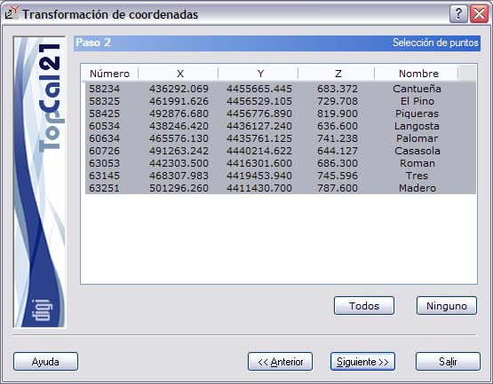

# Step 2: Point selection
<!-- id: topcal21-transformacion-helmert-de-coordenadas-paso-2-seleccion-de-puntos -->
<!-- origen: f8c1016d8cbed877e3cef1b5adcb2dae0bc2a315 -->

This is the second step in computing the transformation, in which a screen is displayed with the points with coordinates stored in the current file. Select the points you want to transform.

The list that is displayed contains the following fields:

* **Point number**
* **Point coordinates**
* **Point name**

You can select multiple points by holding down the *\[CTRL\]* key and clicking the desired points with the left mouse button. If you click a point that is already selected, it is deselected.

You can also select points arranged in ranges by holding down the *\[SHIFT\]* key and clicking with the left mouse button the limit points that define the range.

Likewise, you can use the **All** or **None** buttons to select or deselect all the points.

When you have selected the desired points, you can click the **Next** button to go to [Step 3: Output data setup](paso-3-configurar-salida-de-datos.md), or return to [Step 1: Choose transformation parameters](paso-1-elegir-parametros-de-transformacion.md) by clicking the **Back** button.
