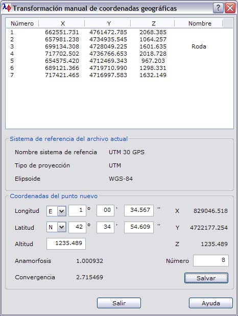

# Manual transformation of geographic coordinates
<!-- id: transformacion-manual-de-coordenadas-geograficas -->
<!-- origen: f518687a7902144d15ae8fdfa7b46b623966df28 -->

This tool is used to transform geographic coordinates entered manually into the reference system of the current point file.

The program shows a dialog box with a list of coordinates of the points stored in the current file and the characteristics of the reference system, which indicate the projection and the ellipsoid used.

To add new points, you can specify the geographic **latitude** and **longitude** by entering sexagesimal degrees, minutes and seconds. You must also specify the hemisphere and whether the point is east or west of the prime meridian. You can also enter the **height** and the **number** of the point. Click **Save** to add the point, including its height and point number, to the current point file.

As you enter the geographic coordinates, the program automatically computes the transformed coordinates referred to the coordinate system of the current file, the projection scale factor (linear anamorphosis) and the meridian convergence in sexagesimal degrees.
