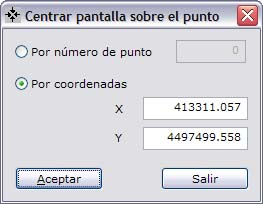

# Fit view on point
<!-- id: centrar-pantalla-sobre-punto -->
<!-- origen: 76b12a5f8e3838e34e81bc0840ef51dbe7efa0c9 -->

The program can center the sketch view on coordinates entered by the user or on a point identified by its point number.

