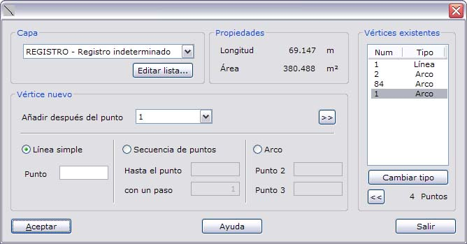

# Draw entity
<!-- id: dibuja-entidad -->
<!-- origen: 79cbd8b33179b6ecd9bc995a12e5fe391b827ed0 -->

This tool registers entities in the sketch file from the points related to it. To do so, it needs an entity code, which you can choose from the existing code list, and the sequence of points that make up the entity.

You can enter the points one by one, through a continuous sequence of points, or as points that make up an arc.

The program shows the points that make up the entity, its length and, if it is closed, its area.

The fields that appear in this dialog box are the following:

* **Layer**: You can choose a layer for the entity being registered. If the layer is not among those shown, you can display the [Code list](../opciones-de-visualizacion/preferencias-de-dibujo/listado-de-codigos-de-dibujo.md) dialog box with the **Edit list** button to add the ones you want.
* **Properties**: This section shows the total **length** of the registered line and its **area**, if the first and last points coincide.
* **New point**: With the fields that appear here you can add new vertices to the line in several ways. In the **Add after point** field, you can select where to start adding points, so that you can add points at the beginning, in the middle or at the end of the line. Vertices can be entered in several ways:
  * **Simple line**: To enter individual points.
  * **Sequence of points**: To enter an ordered sequence of points, for example, the points from 100 to 110 with a step of 2: 100, 102, 104, 106, 108 and 110. The **step** value can be negative.
  * **Arc**: To enter an arc that passes through three points. To register an arc you must enter at least two points to generate the arc together with the previous point. However, if the arc is defined by more than three points, you can fill in only the first field.

  To accept the new point, press the *\[Enter\]* key or click the **>>** button.
* **Existing points**: Shows a list with the existing vertices, their type and their quantity. You can remove a point from the list by clicking the **&lt;&lt;** button.
* **Change type**: When you select a point, you can change the way it takes part in the line, that is, whether it is a straight segment or part of an arc. Changing the type of a point can also change the type of other points of the line, because registering an arc requires at least two points of type **Arc**.

