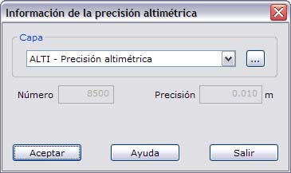

# Altimetry accuracy information
<!-- id: informacion-de-la-precision-altimetrica -->
<!-- origen: 82786ef1c76f62d6aa97c3c358249ad3c016b60b -->

This dialog box shows the properties of the altimetric accuracy of a point when it is selected from the sketch view. The data shown cannot be modified, except the drawing layer in which the line is registered. The data shown are the following:

* **Layer**: Drawing layer in which the line that represents the altimetric accuracy is registered. If the layer you want is not in the list, you can click the button on the right to create a new layer.
* **Number**
* **Altimetric accuracy value**

Click the **OK** button to save the layer change. Click the **Exit** button to close the dialog box.

