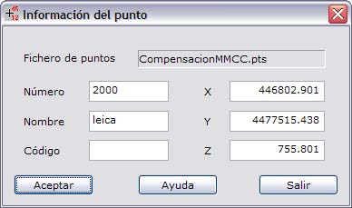

# Point information
<!-- id: informacion-del-punto -->
<!-- origen: aa45ec43164a65bcc9af910ff8a48812f41f1209 -->

This dialog box shows the properties of a point when it is selected from the sketch view. You can modify the data of the point; the program saves the modified data in the point file to which the point belongs. The data shown are the following:

* **Points file**: Name of the file to which the point belongs.
* **Number**
* **Name**
* **Code**
* **Point coordinates**

Click the **OK** button to save the changes of the point. Click the **Exit** button to close the dialog box.

