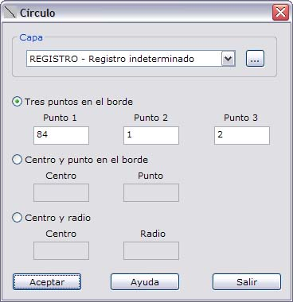

# Insert circle
<!-- id: insertar-circulo -->
<!-- origen: 519bcdb94f213eff8f00c870bdd6e00a9bb92798 -->

This tool registers entities in the form of a closed circle from a combination of different data: center, radius, points on the boundary, etc. The program shows a dialog box where you must enter these data and the code or layer in which the entity is registered.

In this dialog box you can choose how to enter the data of the new circle. These options correspond to the following combinations of data:

* **Three points on the edge**: Enter the numbers of three points located on the edge of the circle.
* **Center and point on the edge**: Enter the number of the point that acts as the center of the circle and a point on the edge.
* **Center and radius**: Enter the number of the point that acts as the center of the circle and the value of the radius of the circle in meters.

If any of the points does not exist, the program shows an error message. In addition, for the last two options, to register the entity the program needs to compute additional points, which are stored in a list of the sketch itself.

If the layer you want is not in the list of layers, you can click the button on the right to create a new layer.

