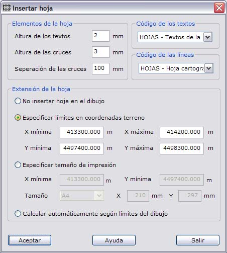

# Insert sheet
<!-- id: topcal21-insertar-hoja -->
<!-- origen: ddebfaa37fc6f0f5e4091fb4d951e124f8567d7b -->

The program can automatically add to the drawing a sheet frame with reference crosses and coordinates at the ends. Inserting this sheet lets the user print the document with a reference to the coordinates where the generated drawing is located.

This sheet can be inserted from coordinates in the same reference system as the drawing, from a print sheet, or automatically from the extents of the drawing.

The program shows a dialog box where you can set up the sheet and the way it is inserted. The fields that appear are the following:

* **Frame entities**: Enter the dimensions of the elements that the sheet contains. These dimensions are given in millimeters, so their size on the screen depends on the **scale** of the drawing. You can change this scale in the [sketch properties](../opciones-de-visualizacion/propiedades-de-los-objetos/propiedades-del-archivo-de-croquis.md).
* **Texts height**: Height of the texts with the coordinates that appear in the margins of the sheet.
* **Tics height**: Height of the crosses that appear inside the sheet.
* **Tics separation**: Separation between the crosses of the sheet. The texts with the coordinates are placed at the intersection with the limits of the sheets.
* **Texts code**: Code used to register the texts with the coordinates.
* **Frame code**: Code used to register the limits and the crosses of the sheet.
* **Frame dimensions**: There are several ways to include the sheet:
  * **No insert frame in document**.
  * **Set dimensions in ground coordinates**: You specify the ground coordinates, that is, in the same reference system as the drawing, of the upper-right corner and the lower-left corner. The application expects the limits entered manually to be multiples of the separation between crosses, so that the crosses are evenly distributed inside the sheet. If they are not, the program asks whether you want to make them multiples or keep those limits. If you decide that the program makes the limits multiples, it looks for the nearest minimum coordinates below and the nearest maximum coordinates above.
  * **Set print size**: You can specify the size of the print sheet and the coordinates of the lower-left corner where the sheet is inserted. Logically, the way the print sheet is inserted, whose dimensions are defined in millimeters, depends on the **scale** of the drawing.
  * **Compute dimensions to fit document**: The program can automatically compute the sheet that includes the whole drawing and whose corner coordinates are multiples of the separation between the crosses of the sheet.

