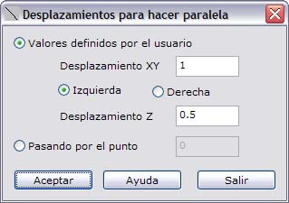

# Insert parallel
<!-- id: insertar-paralela -->
<!-- origen: d2042fbc37e06e1645b8a642987346e34150d3d1 -->

This tool generates a parallel to a registered entity. To do so, select the entity from which you want to generate the parallel by clicking it with the left mouse button. If the entity you want is not selected, you can click the right mouse button so that the program keeps searching for entities at the same location. Once the entity you want is selected, click the left mouse button again to accept the selection.

The program then shows a dialog box where you can choose how to compute the position through which the parallel passes. This dialog box shows the following fields:

* **User-defined values**: Choose this option if you know the displacement values of the new entity.
  * **Displacement XY**: Enter the value of the planimetric displacement in meters and the place where the new entity is located, to the left or to the right of the original line.
  * **Displacement Z**: Enter the value of the altimetric displacement in meters.
* **Through point**: Choose this option if you want the new entity to pass through a specific point. The altimetric displacement is determined by the elevation difference between the selected point and the elevation of the projection of this point onto the original entity.

To register the entity, the program needs to compute the points of the new line, which are stored in a list of the sketch itself.

