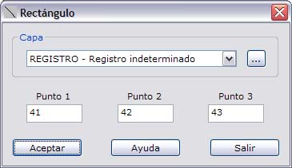

# Insert rectangle
<!-- id: insertar-rectangulo -->
<!-- origen: 2133980b610f9d9186b76c9b0fdfc89a3376e2e4 -->

This tool registers quadrilateral entities in the sketch file from three corner points. The program shows a dialog box where you must enter these three points and the code or layer in which the entity is registered.

If the layer you want is not in the list of layers, you can click the button on the right to create a new layer.

If any of the points does not exist, the program shows an error message. In addition, to register the entity the program needs to compute one additional point, which is stored in a list of the sketch itself.

