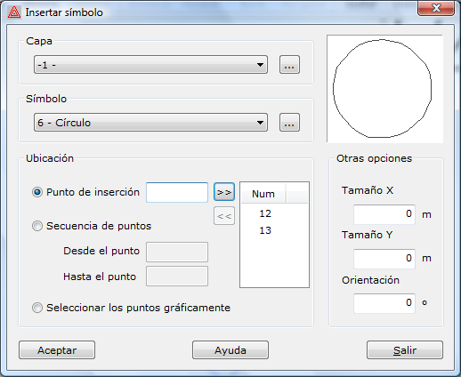

# Insert symbol
<!-- id: insertar-simbolo -->
<!-- origen: 1768e867eea9392cab68aff717fc462141709d41 -->

With this tool you can add point symbols to the sketch, located at points that belong to the point files related to it. You only have to enter the symbol number, the layer where it is registered and the insertion point number.

The fields shown in the dialog box are the following:

* **Layer**: Enter the name of the layer where the symbol is registered. You can choose it from the list shown or open the [Drawing code list](../opciones-de-visualizacion/preferencias-de-dibujo/listado-de-codigos-de-dibujo.md) dialog box to create a drawing code by clicking the **…** button to the right of the list
* **Symbol**: Choose the symbol you want to insert from the available list. If the symbol you want is not there, you can open the [Symbol library](../opciones-de-visualizacion/preferencias-de-simbolizacion/libreria-de-simbolos.md) dialog box to create a symbol by clicking the **…** button to the right of the list
* **Location**: The insertion location can be a single point or a continuous sequence of points. Choose the point or the sequence of points and click the **>>** button to add the points to the list on the right. You can remove a point from this list by clicking the **&lt;&lt;** button. You cannot change the insertion location if you are modifying an existing symbol. The insertion options are:
  * **Insertion point**: Enter the number of the point where you want to insert the symbol.
  * **Sequence of points**: Enter the limits of the sequence of points to insert, and the program inserts a symbol at each point between these limits.
  * **Select points on drawing**: When you select this option, the program returns to the sketch screen so that you can graphically select the points where you want to insert the symbol selected in the dialog box. You can finish the insertion of symbols by pressing the **ESC** key, selecting another tool, or selecting the **Pointer** tool.
* **Other options**:
  * **Size X**: Size of the symbol in X.
  * **Size Y**: Size of the symbol in Y.
  * **Orientation**: Orientation of the symbol.

