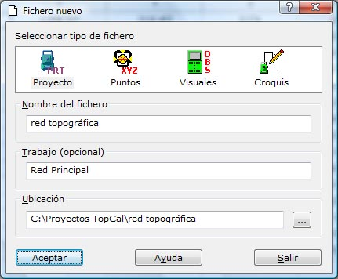
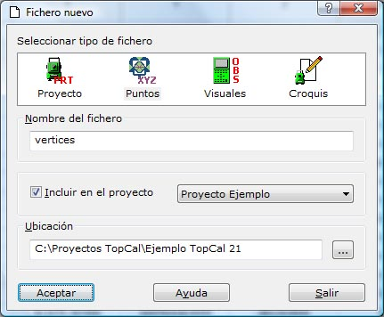
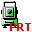
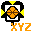
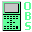
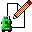

# New file
<!-- id: fichero-nuevo -->
<!-- origen: 4c15daf56d49397e18cce33e2f898620aa3500b2 -->

From this dialog box you can create a new file: a project, a point file, an observation file or a sketch file. Select the type of file to create in the list of icons at the top of the dialog box. The fields shown are the following:

* **File type**:
  * : [Project](fichero-de-proyecto.md): Relates the different files that make up a job
  * : [Point file](ficheros-de-puntos.md): Where the points taken in the survey are stored
  * : [Observation file](ficheros-de-visuales.md): Where the observations made and stored during data collection are stored
  * : [Sketch file](fichero-de-croquis.md): Where the geographic entities generated by joining points previously stored in point files are stored
* **File name**: Enter the name of the file the program will create.
* **Job name**: If you choose to create a new project, enter a descriptive text for the project created.
* **Include into project**: If you choose to create a point file, an observation file or a sketch file, you can choose to add it to one of the currently open projects. These projects are in the list shown to its right. If you do not want to add it to any project, it is created in the **Other files** section.
* **Folder**: Enter the folder where the file is going to be created. If you choose to create a new project, the program creates a new folder inside this location. To choose another location, click the **…** button to the right.
