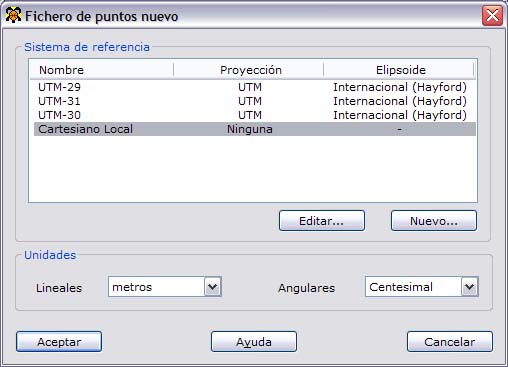

# Point file
<!-- id: fichero-de-puntos -->
<!-- origen: 1ded7a757096e7c0da51d51610d22dbf87ddf130 -->

This type of file stores points whose coordinates refer to the coordinate system defined when the file was created.

These points are defined by:

* **Point number**: It must be numeric and uniquely identifies the point. In other words, it is the field that identifies a point, so the program does not allow two points with the same number. If this field is set to zero, the program interprets the point as deleted.
* **XYZ coordinates**: The coordinates entered manually or calculated by the program. These three fields are numeric and accept decimals. They refer to the coordinate system defined in the file.
* **Orientation**: The angular orientation, entered manually or calculated by the program, that the theodolite had at the time of setting up the station at that point.
* **Name**: Alphanumeric name of the point.
* **Code**: Code recorded in the field that belongs to the geographic entity the point is part of. To see which codes are registered in the work session, see the [Code library](../opciones-de-visualizacion/preferencias-de-croquizacion/lista-de-codigos-de-croquizacion.md) dialog box.

When you choose to create a new point file, the application shows the following dialog box, where you can specify the coordinate system to which the coordinates of the points refer:

In this dialog box you must choose the following parameters:

* **Reference system**: The reference system corresponds to the coordinates of the points and consists of a projection and a reference ellipsoid. The reference systems previously stored in the program are shown, and they can be edited or added using the buttons below the list. If you edit or add a reference system, a dialog box is shown, explained in detail in [New reference system](../otros-comandos/sistemas-de-referencia/sistema-de-referencia-nuevo.md).
* **Linear units**: Choose the units in which the coordinates of the points are stored. You can choose between meters and feet.
* **Angular units**: Choose the units in which the orientations of the points are stored. You can choose between *grads*, *degrees* and *pseudodecimal degrees*.

Once these parameters have been chosen and accepted, the main program window, which corresponds to the spreadsheet, is activated so you can start editing the point file. The fields shown are variable and you can choose them. To do so, go to the [Preferences](../opciones-de-visualizacion/preferencias.md) dialog box in the [Edit](../menus-de-la-aplicacion/menu-editar.md) menu.

TopCal 21 point files have the extension **PTS** by default.
