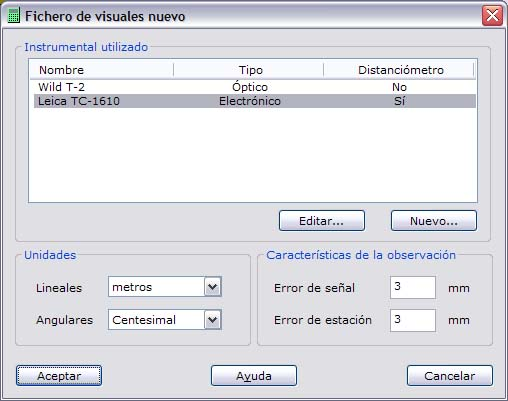

# Observation file
<!-- id: fichero-de-visuales -->
<!-- origen: c2ca31b2d00e3964a4248e0b62f156f88d1b8fd5 -->

This type of file stores the observations made with a surveying instrument during data collection.

Surveying observations are defined by:

* **Station number**: This field identifies the station point where the surveying instrument was set up at the time of data collection.
* **Target number**: This field identifies the point that was sighted with this surveying observation.
* **Horizontal**: This field holds the value of the horizontal angle recorded during data collection, in the angular units defined in the file.
* **Vertical**: This field holds the value of the vertical or zenith angle recorded during data collection, in the angular units defined in the file.
* **Distance**: This field holds the value of the distance recorded during data collection, in the linear units defined in the file.
* **Reflector**: This field holds the value of the height of the rod or prism at the time of data collection, in the linear units defined in the file.
* **Instrument**: This field holds the value of the instrument height at the time of data collection, in the linear units defined in the file.
* **Code**: Code recorded in the field that belongs to the geographic entity the sighted point is part of.

To perform surveying calculations, the program relates the point files and the observation files through the **Number** field of the former and the **Station number** and **Target number** fields of the latter. For example, when a radial survey is performed from a station, the coordinates of this station must be stored in the point file with a given number. This number must match the **Station** field of the observation file. After the calculations are done, the program saves in the point file as many points as observations were made, with the number given by the **Target** field of those observations.

The program allows you to store in the same file observations between the same station and the same target, for example when observations between points are repeated to improve the calculation, or when observations are made in direct and inverse circle to correct the observations for systematic errors of the instrument using Bessel's rule. To store repeated observations between the same station and target point, enable **Duplicated observations** in the [Preferences](../opciones-de-visualizacion/preferencias.md) dialog box of the [Edit](../menus-de-la-aplicacion/menu-editar.md) menu.

When you choose to create a new observation file, the application shows the following dialog box, where you can specify the surveying instrument used and the observation conditions:

In this dialog box you must choose the following parameters:

* **Instruments**: The program shows a list of the stored surveying instruments, from which you can choose the one used. You can also edit or add a new one using the buttons below the list. If you edit or add a surveying instrument, a dialog box is shown, explained in detail in [New surveying instrument](../otros-comandos/instrumentos-topograficos/instrumento-topografico-nuevo.md).
* **Linear units**: Choose the units in which the distances, reflector heights and instrument heights are recorded. You can choose between meters and feet.
* **Angular units**: Choose the units in which the horizontal and vertical angles of the observations are stored. You can choose between *grads*, *degrees* and *pseudodecimal degrees*.
* **Observation features**: Tell the program the error made in each station setup and in each signaling of the points used in the observations, in millimeters. As a reference, you can enter 5 mm for the station setup error and 5 mm for the signaling error.

Once these parameters have been chosen, the main program window, which corresponds to the spreadsheet, is activated so you can start editing the observation file. The fields shown are variable and you can choose them. To do so, go to the [Preferences](../opciones-de-visualizacion/preferencias.md) dialog box in the [Edit](../menus-de-la-aplicacion/menu-editar.md) menu.

TopCal 21 observation files have the extension **OBS** by default.
