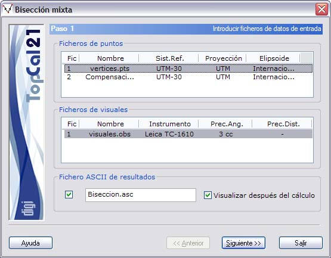

# Step 1: Enter input data files
<!-- id: topcal21-biseccion-mixta-paso-1-introducir-ficheros-de-datos-de-entrada -->
<!-- origen: aed11e221f90bb9b77443ff02f38feaf71b9e609 -->

This is the first step in computing a 2-point resection. The required data are the following:

* **Point files**: Select the point files of the project that you want to use in the intersections. You can continue the computation only if all the selected point files refer to the same reference system.
* **Observation files**: Select the observation files of the project that contain the observations used in the computation.
* **Results file**: Enter the name of the output file with the results of the computation. This file can be in **html** or **ASCII** format. If the extension of this file is HTM or html, it is treated as html format; otherwise, it is treated as ASCII format. You can view this file (with the viewer set in the [Preferences](../../opciones-de-visualizacion/preferencias.md) dialog box of the [Edit](../../menus-de-la-aplicacion/menu-editar.md) menu) if you select the check box at the bottom named **Show after computation**. If you do not want to create this file, clear the check box to the left of the name. The file is created in the project directory.

After entering these data, you can click the **Next** button to go to [Step 2: Calculation and output data setup](paso-2-configurar-calculo-y-salida-de-datos.md).
