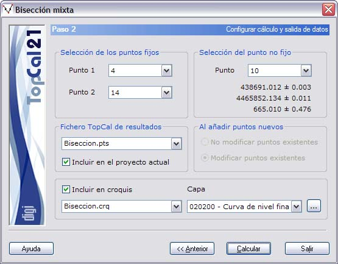

# Step 2: Calculation and output data setup
<!-- id: topcal21-biseccion-mixta-paso-2-configurar-calculo-y-salida-de-datos -->
<!-- origen: 910ca09439344679a4313eae7d736829b364fef0 -->

This is the second and last step in the computation of a 2-point resection.

This screen lets you select the points of the computation and set up the output data, and it shows the computed coordinates. The following fields are shown:

* **Fixed point selection**: Two lists are shown where you must choose the points that are treated as known data in the computation. These points must have their coordinates stored in the point files selected in the previous step. In addition, to compute the elevation of the point correctly, it is important that these points have an elevation. The order of selection does not alter the computation.
* **Not fixed point selection**: A list is shown where you must choose the point whose coordinates you want to compute. This list shows only the points that have at least observations (with at least one distance) to the chosen fixed points in the observation files selected in the previous step. As you select the fixed points, this list changes, adding the points that meet this condition. The order of selection does not alter the computation.
* **Results**: Shows the XYZ coordinates of the point considered not fixed, plus the difference found between the two possible ways of solving it. If the point could not be computed, a message with the error that occurred is shown.
* **TopCal output file**: You can select the name of the TopCal file where the points are stored. You can choose one of the existing files or generate a new file. If you want to generate a new file, you can choose whether or not to add the file to the current project.
* **Adding new points**: If the point file is not new, you can choose whether or not to modify the points with the same number that exist in the chosen output file.
* **Sketch**: You can select the name of the TopCal sketch file where a graphic of the intersection is registered. You can choose one of the existing files or generate a new file. You can also specify the **layer** in which the lines of the graphic are registered.

After setting up the output data, you can finish the process by clicking the **Compute** button, or go back to the previous step, [Step 1: Enter input data files](paso-1-introducir-ficheros-de-datos-de-entrada.md), by clicking the **Back** button.
