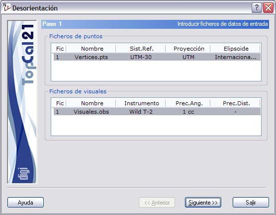

# Step 1: Enter input data files
<!-- id: topcal21-calculo-de-desorientaciones-paso-1-introducir-ficheros-de-datos-de-entrada -->
<!-- origen: 392046f61bd080b97c24d71025170e12c55d81c6 -->

This is the first step in computing the orientation of a station. The required data are the following:

* **Point files**: Select the point files of the project that you want to use in the computation of the orientations. You can continue the computation only if all the selected point files refer to the same reference system.
* **Observation files**: Select the observation files of the project that contain the observations used in the computation.

After entering these data, you can click the **Next** button to go to [Step 2: Station selection](paso-2-seleccion-de-la-estacion.md).
