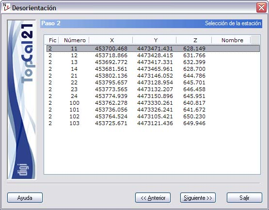

# Step 2: Station selection
<!-- id: topcal21-calculo-de-desorientaciones-paso-2-seleccion-de-la-estacion -->
<!-- origen: a00cfe39cb580bdfe7a134200f62e6cab07dc634 -->

In this second step, a screen shows the points with coordinates stored in the point files selected in *Step 1* that act as a station in any of the observation files selected in the same step. In this list you must select the station whose orientation you want to compute.

The list that is shown contains the following fields:

* **File index**: Indicates the index of the point file where the point is stored
* **Point number**
* **Point coordinates**
* **Point name**

After selecting the station, you can click the **Next** button to go to [Step 3: Observation selection](paso-3-seleccion-de-visuales.md), or go back to [Step 1: Enter input data files](paso-1-introducir-ficheros-de-datos-de-entrada.md) by clicking the **Back** button.
