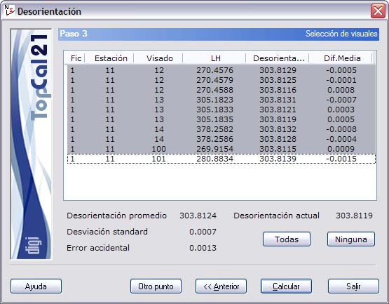

# Step 3: Observation selection
<!-- id: topcal21-calculo-de-desorientaciones-paso-3-seleccion-de-visuales -->
<!-- origen: 79a01c96b0ddaee3995c2763c1b74d34ef746862 -->

In this last step, a screen shows the observations stored in the observation files selected in *Step 1* whose station is the one selected in *Step 2*, provided that the target points have coordinates stored in the point files selected in *Step 1*.

The list that is shown contains the following fields:

* **File index**: Indicates the index of the observation file where the observation is stored.
* **Station point number**
* **Target point number**
* **Horizontal angle**
* **Orientation**: Orientation computed with that horizontal angle
* **Difference from the mean**: Difference between the orientation computed with that angle and the mean of all the selected orientations. If the difference from the mean exceeds the azimuthal accidental error, check the observation and clear its selection if you decide to exclude it from the computation.

You can select multiple observations by holding the *\[CTRL\]* key and clicking the desired observations with the left mouse button. If you click an observation that is already selected, it is deselected.

You can also select observations arranged in ranges, by pressing the *\[SHIFT\]* key and clicking with the left mouse button the limit observations that define the range.

Likewise, you can use the **All** or **None** buttons to select or deselect all the observations.

Depending on the selected observations, the mean of the orientations is computed simultaneously and shown in the **Mean orientation** field. The **current orientation**, stored in the station point, the **standard deviation** of the whole series and the azimuthal **accidental error** are also given, to assess whether the computations are suitable. If the deviation from the mean of any of the points is greater than this accidental error, you should deselect that observation to improve the computation.

After setting up the output data, you can finish the process by clicking the **Compute** button, or go back to the previous step, [Step 2: Station selection](paso-2-seleccion-de-la-estacion.md), by clicking the **Back** button. You can also save the orientation for this station and compute the orientation again for another point by clicking the **Another point** button.
